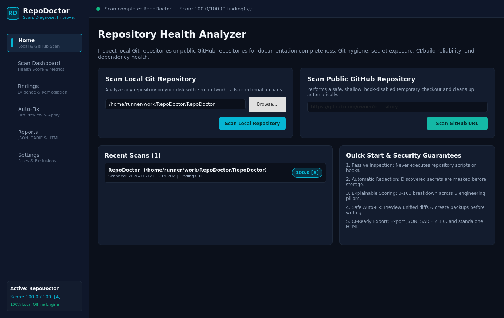
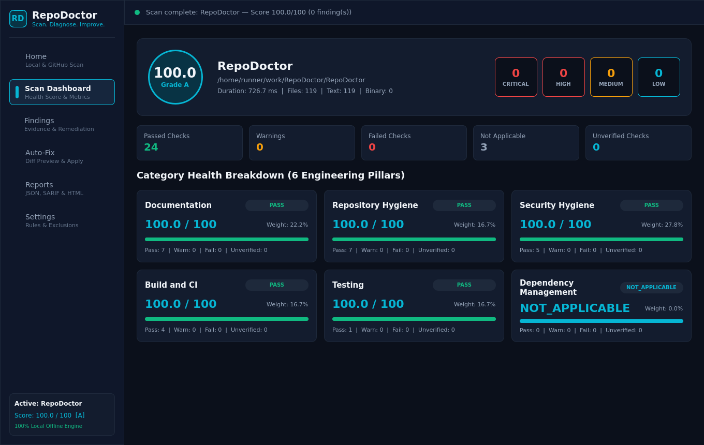
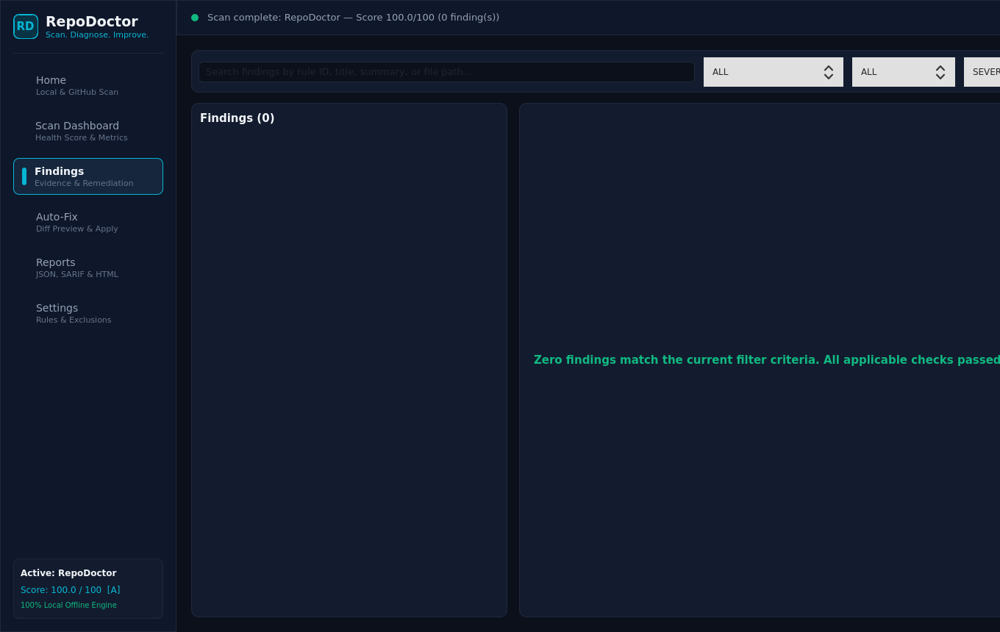
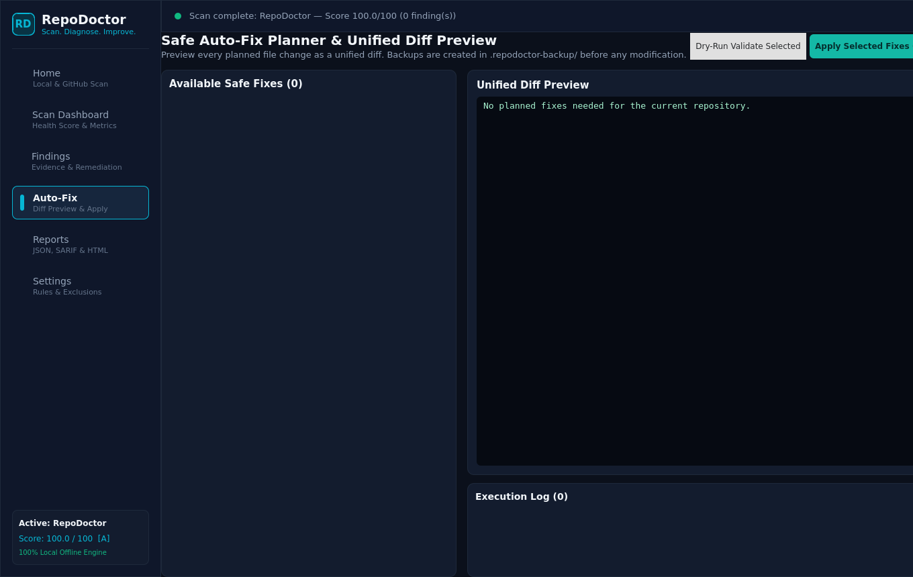
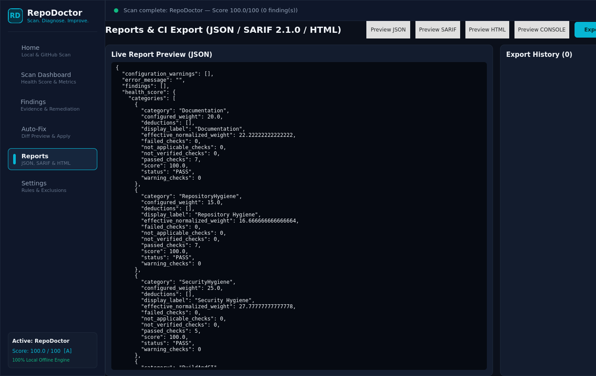
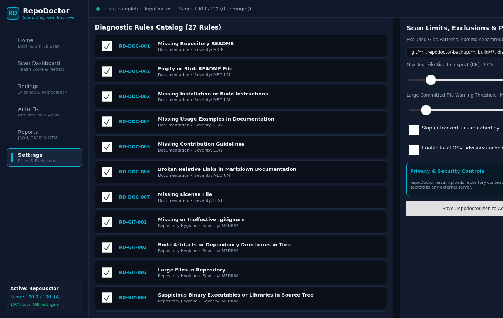

# RepoDoctor — Open-Source Repository Health Analyzer

[](https://github.com/UmitGUL1/RepoDoctor/actions/workflows/ci.yml)

**Tagline**: *Scan. Diagnose. Improve.*

**RepoDoctor** is a cross-platform C++20 developer tool (providing both the `repodoctor-cli` command-line executable and the `RepoDoctor` Qt 6 / QML desktop application) for inspecting local Git repositories and public GitHub repositories. It detects actionable engineering problems across documentation, Git hygiene, credential & secret exposure, CI/CD & build quality, testing integration, and dependency management—and generates console, JSON, OASIS SARIF v2.1.0, and HTML reports alongside previewable, non-destructive auto-fixes.

> **100% Offline & Private by Default**: Local repository analysis requires no user account, no subscription, no AI API key, and no external cloud service.

---

## Desktop interface

Screenshots captured from the running Qt/QML application in the [verified build](https://github.com/UmitGUL1/RepoDoctor/actions/runs/39035974034).

| Home | Dashboard |
|---|---|
|  |  |

| Findings | Auto-Fix |
|---|---|
|  |  |

| Reports | Settings |
|---|---|
|  |  |

## Key Capabilities

1. **Pure C++20 Core Engine (`repodoctor_core`)**: Strictly decoupled from Qt; uses `std::filesystem`, `nlohmann/json`, and `libgit2` (with an automatic binary/text `.git/` and `.git/index` v2/v3 fallback).
2. **27 Built-In Diagnostic Rules**: Covers Documentation (`RD-DOC-*`), Repository/Git Hygiene (`RD-GIT-*`), Security & Secret Hygiene (`RD-SEC-*`), Build & CI (`RD-BLD-*`), Testing (`RD-BLD-002`), and Dependency Management (`RD-DEP-*`).
3. **Secret Detection & Redacted Evidence**: Context-aware scanning for AWS keys, GitHub tokens, Slack tokens, Stripe live keys, Google API keys, PEM/OpenSSH private keys, `.env` files, and connection string passwords. All matches are masked before storage (`SecretDetectionEngine::redactSecretValue()`).
4. **Transparent 0–100 Health Score**: Configurable category weights, explainable per-finding deductions, automatic weight re-normalization for `NOT_APPLICABLE` categories, and honest handling of `NOT_VERIFIED` checks (never treated as `PASS`).
5. **Safe Auto-Fix Subsystem**: Separate `FixPlanner` and `FixExecutor` layers that generate unified diffs, block path traversal and symlink escapes, detect file conflicts, create `.repodoctor-backup/` snapshots, and require explicit confirmation.

---

> See [verification status](IMPLEMENTATION_STATUS.md) for the tested revision and known limits.

## Installation & Building

### Download the Windows application

1. Open [GitHub Actions](https://github.com/UmitGUL1/RepoDoctor/actions/workflows/ci.yml).
2. Select the latest **successful** run and download the **repodoctor-windows-x64** artifact.
3. Extract the whole ZIP and open **RepoDoctor.exe**. Keep the DLLs and plugin folders beside it.

The package contains the GUI, CLI, Qt runtime and MSVC runtime. It needs no
compiler or separate Qt installation. Public GitHub scans require Git and a
network connection; local scans work offline.

The **repodoctor-linux-x64** artifact contains the Linux binaries and fresh
screenshots. Linux binaries require the system Qt 6/libgit2 runtime; they are
not a statically linked AppImage. Ubuntu 24.04 is the verified Linux target.

### Building from Source

```bash
# Ubuntu / Debian prerequisites
sudo apt-get install cmake ninja-build libgit2-dev nlohmann-json3-dev libgtest-dev \
  qt6-base-dev qt6-declarative-dev libqt6quick6 libqt6quickcontrols2-6 \
  qml6-module-qtquick qml6-module-qtquick-controls qml6-module-qtquick-layouts \
  qml6-module-qtquick-window qml6-module-qtquick-templates qml6-module-qtqml-workerscript

# Configure and build Release
cmake --preset linux-release
cmake --build build/linux --parallel

# Run automated GoogleTest suite
ctest --test-dir build/linux --output-on-failure --no-tests=error
```

---

## Advanced scanning

Scan staged index contents with `--staged`, compare working files with `--since REF`,
inspect past snapshots with `--scan-history --max-commits 50`, and accept reviewed
existing findings with version 2 baselines. Git is required for incremental/history
scans. Read the [semantics, limits and baseline migration guide](docs/advanced-scanning.md)
before adding these options to CI.

## CLI Usage & Examples

```bash
# Scan the current repository and print a console health report
repodoctor-cli scan .

# Scan a specific project path
repodoctor-cli scan ./my-project

# Scan a public GitHub repository (safe shallow clone in temp dir)
repodoctor-cli scan https://github.com/nlohmann/json

# Export machine-readable JSON or OASIS SARIF 2.1.0 for CI pipelines
repodoctor-cli scan . --format json
repodoctor-cli scan . --format sarif --output report.sarif

# Export a self-contained dark-theme HTML report
repodoctor-cli scan . --format html --output report.html

# List all 27 registered rules
repodoctor-cli rules

# Explain a specific rule's detection logic, remediation, and false-positive notes
repodoctor-cli explain RD-SEC-001

# Preview safe auto-fixes and unified diffs without modifying any files
repodoctor-cli fix . --dry-run

# Apply safe auto-fixes with backup creation in .repodoctor-backup/
repodoctor-cli fix . --apply --yes
```

### CLI Exit Codes
| Exit Code | Meaning |
|---|---|
| `0` | Success (scan completed with no findings at or above `--fail-on` threshold) |
| `1` | Actionable findings detected at or above the `--fail-on` severity threshold (default: `HIGH`) |
| `2` | Invalid command-line arguments or unknown rule ID |
| `3` | Repository source error (missing path, invalid URL, or clone failure) |
| `4` | Auto-fix conflict or execution error |

---

## Supported Diagnostic Checks (27 Rules)

| Rule ID | Category | Severity | Title | Safe Fix |
|---|---|---|---|---|
| `RD-DOC-001` | Documentation | `HIGH` | Missing Repository README | Yes (`FIX-DOC-README-TEMPLATE`) |
| `RD-DOC-002` | Documentation | `MEDIUM` | Empty or Stub README File | Yes (`FIX-DOC-README-SECTIONS`) |
| `RD-DOC-003` | Documentation | `MEDIUM` | Missing Installation or Build Instructions | Yes (`FIX-DOC-README-SECTIONS`) |
| `RD-DOC-004` | Documentation | `LOW` | Missing Usage Examples in Documentation | Yes (`FIX-DOC-README-SECTIONS`) |
| `RD-DOC-005` | Documentation | `LOW` | Missing Contribution Guidelines | Yes (`FIX-DOC-CONTRIBUTING-TEMPLATE`) |
| `RD-DOC-006` | Documentation | `MEDIUM` | Broken Relative Links in Markdown Documentation | No |
| `RD-DOC-007` | Documentation | `HIGH` | Missing License File *(filename presence check only)* | No |
| `RD-GIT-001` | Repository Hygiene | `MEDIUM` | Missing or Ineffective `.gitignore` | Yes (`FIX-GIT-GITIGNORE-TEMPLATE`) |
| `RD-GIT-002` | Repository Hygiene | `MEDIUM` | Build Artifacts or Dependency Directories in Tree | No |
| `RD-GIT-003` | Repository Hygiene | `MEDIUM` | Large Files in Repository | No |
| `RD-GIT-004` | Repository Hygiene | `MEDIUM` | Suspicious Binary Executables or Libraries in Source Tree | No |
| `RD-GIT-005` | Repository Hygiene | `LOW` | Temporary, Backup, or OS Metadata Files | No |
| `RD-GIT-006` | Repository Hygiene | `HIGH` | Unresolved Git Merge Conflict Markers | No |
| `RD-GIT-007` | Repository Hygiene | `MEDIUM` | Missing or Corrupted Git Repository Metadata | No |
| `RD-SEC-001` | Security Hygiene | `CRITICAL` | Potential Hardcoded Cloud or API Token *(Redacted)* | No |
| `RD-SEC-002` | Security Hygiene | `CRITICAL` | Private Key Material in Repository *(Redacted)* | No |
| `RD-SEC-003` | Security Hygiene | `HIGH` | Exposed Environment (`.env`) Configuration File *(Redacted)* | No |
| `RD-SEC-004` | Security Hygiene | `HIGH` | Hardcoded Password or Connection String Secret *(Redacted)* | No |
| `RD-SEC-005` | Security Hygiene | `MEDIUM` | Unsafe File Permissions on Sensitive or Script Files | No |
| `RD-BLD-001` | Build and CI | `MEDIUM` | Missing Continuous Integration (CI) Workflow | Yes (`FIX-BLD-GITHUB-CI`) |
| `RD-BLD-002` | Testing | `HIGH` | Missing Automated Tests or Test Suite Integration | No |
| `RD-BLD-003` | Build and CI | `MEDIUM` | Mutable or Unpinned GitHub Actions References | No |
| `RD-BLD-004` | Build and CI | `HIGH` | Insecure or Overly Permissive CI Workflow Configuration | No |
| `RD-BLD-005` | Build and CI | `MEDIUM` | Inconsistent or Legacy CMake Configuration | No |
| `RD-DEP-001` | Dependency Management | `MEDIUM` | Missing Dependency Lockfile or Reproducible Baseline | No |
| `RD-DEP-002` | Dependency Management | `MEDIUM` | Unpinned, Wildcard, or Inconsistent Dependency Declarations | No |
| `RD-DEP-003` | Dependency Management | `HIGH` | Dependency Vulnerability Advisory Verification *(Optional Cache)* | No |

---

## Limitations & Engineering Disclaimers

1. **Not Legal Advice**: `RD-DOC-007` checks only for the presence of a non-empty `LICENSE` or `COPYING` file; it does not evaluate legal licensing validity or dependency license compatibility.
2. **Passive Static Inspection**: RepoDoctor never compiles or executes untrusted repository code during a scan. Passing `RD-BLD-*` checks indicates static configuration hygiene, not that the project compiles cleanly on all targets.
3. **Secret History Persistence**: Deleting a secret from the working tree does **not** remove it from Git history. Exposed credentials must be revoked/rotated and purged with `git filter-repo` or BFG Repo-Cleaner.
4. **Heuristic Health Score**: The 0–100 score is a transparent engineering heuristic, not a formal security certification.

---

## Documentation Index

- [System Architecture](docs/architecture.md)
- [Rule Authoring Guide](docs/rule-development.md)
- [Scoring Methodology](docs/scoring.md)
- [Privacy & Data Handling](docs/privacy.md)
- [Testing & Verification Guide](docs/testing.md)
- [Contributing Guidelines](CONTRIBUTING.md)
- [Security Policy](SECURITY.md)
- [Roadmap](ROADMAP.md)
- [Implementation Status](IMPLEMENTATION_STATUS.md)

## License

Released under the [MIT License](LICENSE).
